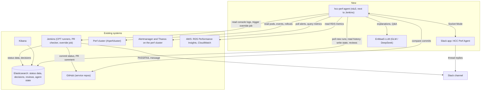
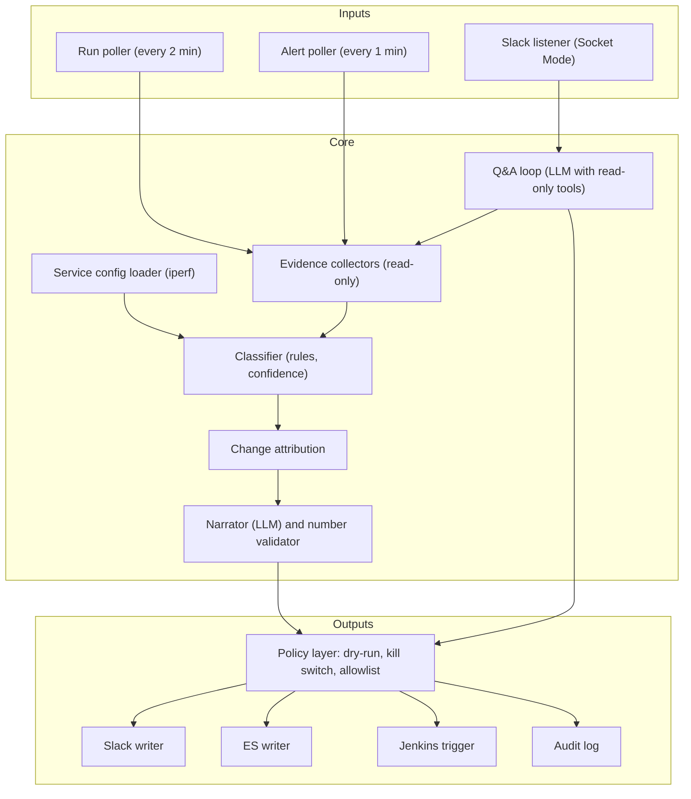
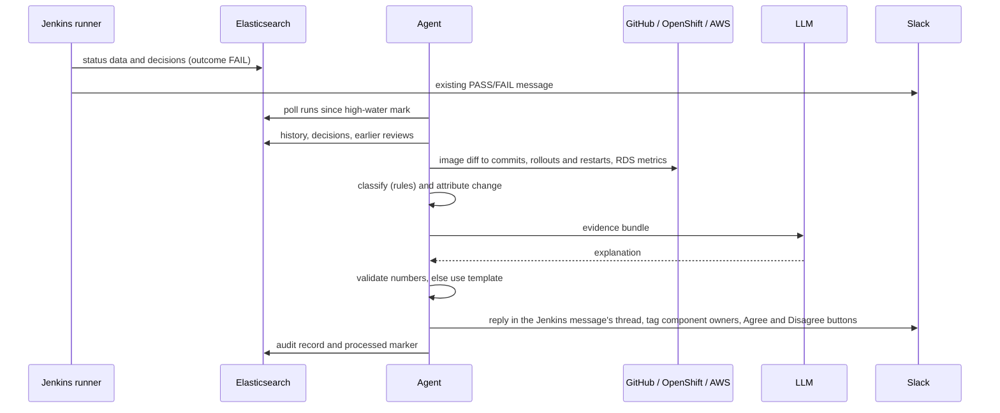
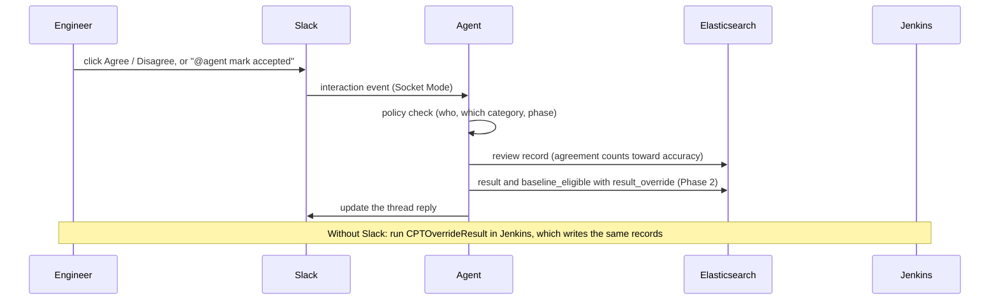
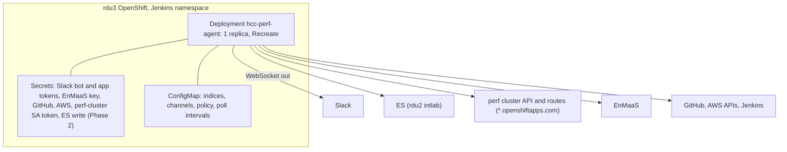

# Perf CPT Agent for HCC Services: Architecture

Status: draft for review. Companion to [PLAN.md](PLAN.md), which covers why and in which
order; this file covers how the pieces fit.

## 1. Principles

1. **The agent advises; Jenkins stays in charge.** CPT runs, `pass_or_fail`, ES uploads,
   GitHub PR statuses, and Slack notifications keep working when the agent is down. The
   agent never becomes part of a build.
2. **Rules decide, the LLM explains.** Verdicts, categories, and numbers come from code with
   fixed rules. The LLM writes prose from an evidence bundle and answers questions with
   read-only tools.
3. **Every write goes through one policy layer.** Dry-run by default, a kill switch, an
   allowlist per category, and an audit record per action.
4. **Read-only by default.** Each external system gets the narrowest credential that works.
   Write credentials are added only in the phase that needs them.
5. **Stateless process, state in ES.** The agent can be restarted or redeployed at any time
   and catches up from ES. No volume to manage.
6. **Two independent tracks share one runtime.** CPT triage and perf-cluster monitoring use
   the same deployment, Slack app, and LLM client, but neither depends on the other.

## 2. Context



## 3. Components

### 3.1 Changes to existing systems (Phase 0)

| Where | Change | PLAN.md |
|---|---|---|
| `opl` | Direction-aware robust band check, time window with `min_runs`, `IMPROVED` outcome, shadow mode, richer decision documents | 5.2–5.5, 5.8 |
| `iperf` | Per-service config in `investigator-conf.yaml`: components, owners, metric direction, band type, gating | 5.7 |
| Status data in ES | `baseline_eligible` field (backfilled), `result_override` history | 5.6 |
| `ci-configs` | `CPTOverrideResult` job; PR runners with `GOLDEN=false` (MR !702); PR re-run on failure | 5.9, 5.12 |
| ES | One-time ReportPortal export into `insights_perf_triage_reviews` | 5.10 |

### 3.2 The agent (one container, one process)



| Module | Responsibility | Built from |
|---|---|---|
| Run poller | Finds runs uploaded since the last high-water mark with outcome `FAIL`, `IMPROVED`, or `ERROR` across the configured status-data indices | New |
| Alert poller | Reads `/api/v2/alerts`, compares to the previous snapshot, and emits started, ongoing, and resolved events for relevant alerts | New |
| Slack listener | Receives `app_mention` events and button clicks over a WebSocket; no inbound endpoint | `slack_bolt` |
| Service config loader | Reads per-service config (components, owners, metric directions) from an `iperf` checkout refreshed on a timer | New; replaces `rp-triage`'s hard-coded table |
| Evidence collectors | One adapter per system, each read-only: ES, Jenkins, GitHub, OpenShift, Alertmanager/Thanos, AWS | ES parts from `rp-triage` `collect.py`, rewritten to start from ES |
| Classifier | Category, confidence, rule that fired, and evidence | `rp-triage` `classify.py` |
| Change attribution | Image tags in this run vs. the last eligible run, mapped to commits, then to changed files; flags docs-only changes and dependency bumps | New |
| Narrator | Turns the evidence bundle into a short explanation; a validator rejects any number or metric name not in the evidence and falls back to a fixed template | New |
| Q&A loop | Answers questions in a thread using the run's evidence and the same read-only collectors as tools. It has no write tools; commands such as "mark accepted" are parsed by code, not the LLM | New |
| Policy layer | The only path to any write. Checks the kill switch, dry-run, category allowlist, and the requesting user, then writes an audit record | New |
| Writers | Slack (post or update the thread reply), ES (`result`, `baseline_eligible`, `result_override`, reviews), Jenkins (trigger `CPTOverrideResult`) | `review.py`, `status_data_updater.py --action change` |

### 3.3 Language and libraries

- **Language:** Python 3. `opl`, `rp-triage`, and `status_data_updater.py` are already Python.
- **Libraries:** `slack_bolt` (Socket Mode), `requests` (ES, Jenkins, GitHub,
  Alertmanager), `kubernetes` (perf cluster), `boto3` (AWS), and an OpenAI-compatible
  client for EnMaaS.
- **EnMaaS:** OpenAI-compatible chat completions at `https://api.enmaas.devshift.net/v1`
  (models `rits/zai-org/glm-5-3`, `rits/deepseek-ai/DeepSeek-V4.1-Flash-1017`). Delta's
  no-cost agent profiles already use it with tool calling. The web UI's chat
  (`agent/web/chat.py`) is the first Q&A loop: read-only ES tools, a cap on tool rounds, and
  a trace of the tools it called shown with each answer.
- **Comparable runs:** a job can rotate through several tests, so history and comparisons
  group runs by test name plus scenario, transport, duration and client count. Status data
  joins to decisions on `results.jenkins.build_url`.

## 4. Main flows

### 4.1 CPT run triage (Phase 1)



Finding the Jenkins thread to reply in:

- **Phase 1:** the agent looks up the Jenkins message by searching recent channel history
  for the build URL. Jenkins doesn't change.
- **Later, optionally:** `helperSendSlackMsg` stores `slack.channel` and `slack.ts` from
  the `slackSend` response in status data. This needs the Jenkins Slack plugin in bot-user
  mode.

Replies come from the agent's own Slack app. Any app that is a member of the channel can
reply in a thread under another app's message, so Jenkins can keep its current token.

### 4.2 Reviews and corrections



Slack buttons make reviewing a click, which is what the Phase 1 accuracy target depends on.
The Jenkins job is the fallback and the path for changes made outside Slack.

### 4.3 Questions in a thread (Phase 2)

1. An engineer @mentions the bot in a run's thread.
2. The agent loads that run's evidence bundle from ES and starts the Q&A loop.
3. The LLM may call read-only tools: run history, decisions, image diff, a commit compare,
   pod events, a PromQL query, and the RDS metrics for the run window.
4. Each tool call is limited (rows returned, time range, namespace allowlist) and logged.
5. The answer is posted in the thread.

### 4.4 Perf-cluster alerts (separate track)

1. The alert poller sees a relevant alert start firing.
2. Collectors gather pods, events, and rollouts in its namespace, the related metrics, and
   any CPT runs in progress or just finished.
3. The narrator writes the summary, which is posted in a new thread.
4. Later polls post "still firing" (rate-limited) and "resolved" in the same thread.
5. The alert state is stored so CPT triage can use it as environment evidence.

## 5. Data

| Index | Owner | Contents |
|---|---|---|
| `insights_perf_index_*` (existing) | Jenkins; agent and override job in Phase 2 | Status data, plus `baseline_eligible` and `result_override` |
| `insights_perf_aa_decisions` (existing) | `pass_or_fail` | One decision per metric per run, plus direction, outcome, band, center, and spread |
| `insights_perf_triage_reviews` (existing) | Agent, override job, ReportPortal export | Classifications, human reviews, corrections, known-issue signatures |
| `insights_perf_agent_state` (new) | Agent | Run high-water mark, processed run IDs, the Slack message for each run or alert, alert snapshots |
| `insights_perf_agent_evidence` (new) | Agent | Evidence bundle per triaged run, so Q&A and reviews see what the agent saw |

Idempotency: each run or alert maps to one Slack message, keyed by run ID or alert
fingerprint. Re-processing updates that message instead of posting a new one.

## 6. Deployment



- **One replica, `Recreate` strategy.** Two copies would post twice, and a short gap during
  a redeploy is harmless because the pollers catch up.
- **Web UI behind a Route.** Until the Slack app is approved, a web UI (`agent/web`) is
  the review surface. It runs in `hceperf--runtime-int` behind an oauth-proxy sidecar
  (cluster SSO) on an internal-shard Route. Slack itself still needs no inbound endpoint
  (Socket Mode), and nothing needs a PVC.
- **Image:** rdu3 rejects Docker and Source builds, so GitHub Actions builds the image
  and pushes it to GHCR. An ImageStream with a scheduled import pulls it in, and an image
  trigger rolls out the Deployment. Manifests are in `deploy/base` (kustomize); see
  `deploy/README.md`.
- **Health:** a liveness probe on poller heartbeats. A Slack message goes to the team
  channel if the agent's last successful poll is older than a threshold.
- **Config:**
  - The policy (kill switch, dry-run, allowlist) is in a ConfigMap, so turning off writes
    is a config change.
  - Per-service config is read from `iperf` and isn't duplicated here.

## 7. Security

| Credential | Scope | Phase |
|---|---|---|
| Slack bot token (`xoxb-`) | Scopes in `deploy/slack-app-manifest.yaml` | 1 |
| Slack app-level token (`xapp-`) | `connections:write` (Socket Mode) | 1 |
| ES | Read all CPT indices; write `insights_perf_agent_*` and `insights_perf_triage_reviews` | 1 |
| ES | Write status-data indices (`result`, `baseline_eligible`, `result_override`) | 2 |
| Perf cluster ServiceAccount | `view`, `cluster-monitoring-view`, `monitoring-alertmanager-view` | 1 |
| AWS IAM user `consoledot-perf-team-rds-pi-reader` (existing, from rhperfcluster `cpt/iperf-secret`) | Read-only Performance Insights, `rds:DescribeDBInstances`, CloudWatch; via the corp proxy | 1 (in use by chat) |
| GitHub | Read-only contents and commits for the service repos | 1 |
| Jenkins API token | Read builds; trigger `CPTOverrideResult` only | 1 (read), 2 (trigger) |
| EnMaaS API key | Inference | 1 |

- **The LLM sees evidence only.** It gets CPT metrics, image tags, commit messages and
  changed file names, and cluster events. No secrets, tokens, or customer data are sent to
  it.
- **Slack inputs are untrusted.** Questions are passed to the LLM as user content. The LLM
  has no write tools, so a prompt injection can at most produce a wrong answer, not a
  change.
- **Who may make corrections.** Only users on an allowlist (or a Slack user group) can make
  corrections through Slack. Everyone else can only ask questions.

## 8. Failure behavior

| Failure | Behavior |
|---|---|
| Agent down | CPT, PR checks, and Jenkins Slack messages keep working. On restart, pollers resume from the high-water mark. |
| EnMaaS down or slow | Post the fixed template (category, metrics, change, owners) without prose; Q&A replies say the LLM is unavailable. |
| LLM output fails validation | Use the template and log the rejected output. |
| Slack down | Retry with backoff; runs stay unprocessed until posted. |
| ES down | Skip the cycle; nothing is lost because runs are in ES once it's back. |
| A collector fails (GitHub, AWS, OpenShift) | Report that piece as "not checked"; never guess. Confidence drops accordingly. |
| Alert storm | Group alerts by name and namespace into one thread, and limit messages per poll. |

## 9. Repository layout (proposed)

```
hcc-perf-agent/
  PLAN.md, ARCHITECTURE.md
  agent/
    main.py               # wiring, schedulers
    pollers/              # runs.py, alerts.py
    collectors/           # es.py, jenkins.py, github.py, openshift.py, prometheus.py, aws.py
    triage/               # service_config.py, classify.py, attribution.py
    narrate/              # llm.py, prompts/, validate.py, templates/
    slack_app/            # listener.py, blocks.py, commands.py, qa.py
    web/                  # web UI (exists): runs, run detail, reviews, alerts
    actions/              # policy.py, slack_writer.py, es_writer.py, jenkins_writer.py, audit.py
    state.py
  deploy/                 # kustomize base, slack-app-manifest.yaml
  tools/                  # measure_noise.py, backtest.py, export_reportportal.py
  tests/                  # recorded ES/Slack fixtures; classifier and validator tests
```

## 10. Slack app

A separate app is needed. Jenkins' `coreos-slack-notification-token` can't be reused. The
`slackSend` log line shows `botUser: false, username: jenkins-test`, which means a legacy
"Jenkins CI" integration token. That token can only post: it has no Socket Mode, no
interactivity, and no history scopes. It's also configured only on the
`jenkins-csb-perf-master.dno` controller. The rdu3 controller has neither the Slack plugin
nor the credential, and rdu3 only hosts that controller's agents. Jenkins keeps its token
unchanged; the agent gets its own identity, scopes, and Socket Mode. Until the app is
approved, the web UI (section 6) is the review surface.

### 10.1 Scopes

All scopes are requested at once, so a later phase doesn't need another approval round
(Slack asks for re-approval when scopes change). See
[`deploy/slack-app-manifest.yaml`](deploy/slack-app-manifest.yaml).

| Scope or feature | Why |
|---|---|
| `chat:write` | Post and update thread replies |
| `channels:history` | Find the Jenkins message to reply under; read thread context for Q&A |
| `channels:read` | Resolve channel names to IDs |
| `app_mentions:read` + `app_mention` event | Questions and commands in threads |
| `users:read` | Resolve who clicked or asked, for the correction allowlist and audit records |
| Interactivity | Agree / Disagree buttons |
| Socket Mode | No inbound endpoint needed on rdu3 |

If the target channel is private, `groups:history` and `groups:read` are also needed.

### 10.2 How to get it

1. **Create the app from the manifest.**
   - Go to <https://api.slack.com/apps>, then **Create New App** → **From a manifest**.
   - Choose the Red Hat workspace (`redhat-internal`, the same one Jenkins uses) and paste
     `deploy/slack-app-manifest.yaml`.
2. **Request installation.**
   - Under **Install App**, click **Install to Workspace**.
   - The Red Hat workspace requires admin approval for apps, so this sends a request to
     the workspace's app managers instead of installing right away.
   - In the request message, state:
     - purpose: triage of CPT results and perf-cluster alerts
     - owning team and channels
     - each scope and why (table above)
     - that it uses Socket Mode with no public endpoint
     - that message content is sent to the internal EnMaaS LLM
3. **Add co-owners.** Add at least one more team member as a collaborator under
   **Collaborators**, so the app isn't tied to one person.
4. **Create the app-level token** after approval: **Basic Information** → **App-Level
   Tokens**, scope `connections:write`. Then copy the bot token (`xoxb-`) from **OAuth &
   Permissions**.
5. **Store both tokens as an OpenShift secret** in the agent's namespace. Never put them
   in this repo or in a ConfigMap.
6. **Invite the bot to each channel:** `/invite @HCC Perf Agent` in
   `#forum-cloudservices-cpt` and any team channels.

What I couldn't confirm is who reviews app requests on Red Hat's workspace and whether a
security or data review is also required, especially because messages go to an LLM. Other
teams do run their own apps there (e.g. openshift-eng's "Eddie"), so the route exists. Ask
the Red Hat Slack admins before submitting, and start this early, since approval is likely
the longest wait in Phase 1.
