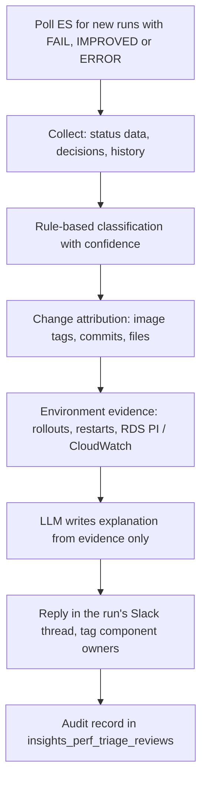

# Perf CPT Agent for HCC Services: Plan

Status: draft for review

## 1. Problem

CPT (continuous performance testing) runs for HCC services decide PASS/FAIL with
`opl`'s `pass_or_fail.py`. Many failures turn out to be false alarms. Today someone fixes
them by hand: they override the result in ReportPortal, and `UtilResultsFromRPToES` syncs
the override back to Elasticsearch (ES). This has three problems:

- ReportPortal is being decommissioned, so the override workflow needs a new home.
- Overrides happen inconsistently, so results in ES and on dashboards are often wrong.
- Engineers get pointed at "regressions" that were noise, an improvement, or an
  infrastructure problem. That includes failures on PRs that only touched docs.

**Constraint:** after ReportPortal is gone, only Jenkins and the ES indices (plus Kibana on
top of them) are left. Every part of this plan has to work with just those, plus Slack,
which Jenkins already posts to.

## 2. Current state (from `iperf`, `opl`, `ci-configs`, `perf-casc`)

| Area | Today |
|---|---|
| Check method | No `investigator-conf.yaml` (32 files in `iperf`) sets `methods`, so all use the default `check_by_min_max_0_1` (`opl/investigator/check.py`): fail if the value is outside the min–max of the history. |
| Direction | Both directions are checked, so a run that is better than every previous one fails. |
| History window | Counted in runs, not time: the last N golden `result: PASS` runs. N is 50 in 23 configs, 500 in 5, 100 in 2, 10 in 2. |
| Baseline membership | Tied to the verdict. Any run that ends up PASS, including manual overrides, joins the history and moves future limits. |
| Per-metric config | `sets` is a flat list of JSON paths. It has no direction, band, owner, or component. |
| Decisions | Each metric decision (value, limits, deviation) is written to ES index `insights_perf_aa_decisions`. |
| Notifications | `helperSendSlackMsg` (`ci-configs/vars/runTest.groovy`) posts PASS/FAIL/ERROR for golden runs through `slackSend` with the credential `coreos-slack-notification-token`. People to tag are listed per job in `globalConfig.slack_notification`. |
| Triage tooling | The `rp-triage` skill classifies failures with rules and records reviewer corrections and accuracy in `insights_perf_triage_reviews`. It runs by hand. Some scripts already work from ES alone: `classify.py` in `--status-data` mode, and `review.py`. Others are tied to ReportPortal: `collect.py` starts from ReportPortal launches, and `apply.py` and `sync.py` exist only to write to ReportPortal and sync it to ES. |
| PR testing | `runPRPerfTest` (`ci-configs/vars/runPRPerfTest.groovy`, jobs in `jenkins/gh-pr-testing/`, currently Kessel API and Notifications) swaps the PR image into the shared perf namespace and triggers the regular runner jobs with `GOLDEN=true`. It then posts a GitHub commit status and a PR comment with the min/max decision table from `insights_perf_aa_decisions`. PR runs therefore use the same two-sided min/max rule. Until ci-configs MR !702 (PR runners with `GOLDEN=false`), a PR run that passed also joined the golden history normal runs are compared against: 178 such runs are still in the baselines, and for `kessel-k6` `check_workspace` they make up 38 of the 50 runs in the current window. |
| Changing results in ES | `opl`'s `status_data_updater.py --action change` already sets fields on a status-data document by run ID and appends an entry to its `comments` list. The ReportPortal sync (`--action rp-to-es`) is built on the same mechanism. |

Most false failures come from the rule (checking both directions, min/max over a run-count
window), not from the tests themselves. Fixing the rule is cheaper and more reliable than
having an agent correct its output afterwards.

## 3. Goals and non-goals

Goals

1. Remove false failures caused by the rule itself: improvements, and a baseline that
   hasn't caught up.
2. Triage the remaining failures automatically, with evidence: what changed, which
   component, and which metric by how much.
3. Tag only the owners of the affected component.
4. Replace ReportPortal as the place where verdicts get corrected, using only Jenkins and ES.
5. Let engineers ask the agent follow-up questions in the Slack thread of the failure.
6. Later: watch the perf cluster for infrastructure problems.

Non-goals

- The LLM never decides a verdict or produces a number. Code with fixed rules decides;
  the LLM explains.
- No automatic suppression of real regressions.
- No automatic infrastructure changes (scaling, restarts).

## 4. Phases

| Phase | Scope | LLM | Writes |
|---|---|---|---|
| 0 | Fix the check in `opl`, per-service config, `baseline_eligible` field, Jenkins override job, export ReportPortal history | No | Normal CI flow; human overrides through Jenkins |
| 1 | Triage agent, report only | Explanations only | Slack replies, audit records |
| 2 | Agent applies corrections on its own for categories it has proven accurate on; Slack Q&A | Yes | Verdict and `baseline_eligible`, with an audit record |

Each phase is useful without the next one.

Monitoring the perf cluster is a separate responsibility with its own track (section 8).
It shares the agent's runtime and Slack integration but doesn't depend on the CPT phases,
and they don't depend on it.

---

## 5. Phase 0: fix the check (no LLM)

### 5.1 Measure noise first

Measure each metric's run-to-run variation before choosing band parameters.
[`tools/measure_noise.py`](tools/measure_noise.py) does this. For every
`investigator-conf.yaml`, it reads the metrics in `sets`, takes golden PASS/FAIL runs
(excluding PR images), and groups comparable runs. For each metric it reports the robust CV
(1.4826 × MAD / median) and the band a robust 3-sigma rule would need (3 × robust CV).

First results (2026-11-17, [30 days](docs/noise-30d.md), [90 days](docs/noise-90d.md)):

| Band needed | 30 days (159 metric series) | 90 days (176 metric series) |
|---|---:|---:|
| ≤ 5% | 21 | 12 |
| 5–10% | 33 | 7 |
| 10–20% | 32 | 41 |
| > 20% | 39 | 79 |
| Median is 0 (needs an absolute limit) | 34 | 37 |

What this shows:

- **A flat ±5% or ±10% band doesn't fit most metrics.** In the 30-day window, only 54 of
  125 non-zero series fit a band of 10% or less. A band sized per metric (5.3) is needed,
  and some metrics should be `gate: false` for now.
- **Noise grows with the window.** Over 90 days, most series need more than 20%. Much of
  the spread is drift and step changes between deployments, not noise within a run. That
  supports a short window (5.4) and detecting step changes (5.5).
- **Within one test, some metrics are steady and others aren't.** For `kessel-k6`
  `check_workspace` (grpc, 300 VUs, 300 s), p95 latency needs a 3.7% band, while median
  latency needs 28.7% and RPS needs 22.6%.
- **Most configs have too little recent data.** Only 7 of 32 configs have at least 5
  comparable normal runs in 30 days, and only 9 in 90 days. Notifications had 16 normal
  runs in 90 days against 461 PR runs. The `min_runs` fallback (5.4) matters, and some
  services can't be gated until they run regularly.

The script groups runs by name, scenario, transport, duration, and client count. For
configs whose history query filters on more parameters (e.g. `inventory`), the groups may
mix setups and overstate noise.

### 5.2 Only fail in the worse direction

Each metric declares which direction is better (`better: lower | higher`). A run gets one
of three outcomes:

| Outcome | Condition | Exit code | Effect |
|---|---|---|---|
| `FAIL` | Beyond the band in the worse direction | 1 | Blocks; owners tagged |
| `IMPROVED` | Beyond the band in the better direction | 0 | Doesn't block; Slack notice asks owners to confirm the change was intended |
| `PASS` | Within the band | 0 | — |

Guard rule: an improvement in latency or throughput doesn't count when `fail_ratio` or
`num_failures` went up or `num_requests` went down. Requests that fail fast, error, or get
cached can look like a speed-up.

Exit codes stay the same, so `helperDetermineResult` keeps working. `IMPROVED` is recorded
in the decision documents and in status data.

### 5.3 A band sized from each metric's own noise

One rule for every metric, with each metric's own numbers:

```
center = median(window)
spread = 1.4826 * MAD(window)            # robust standard-deviation estimate
band   = max(floor_pct * |center|, k * spread)

better: lower  -> FAIL if value > center + band; IMPROVED if value < center - band
better: higher -> FAIL if value < center - band; IMPROVED if value > center + band
```

- `floor_pct` defaults to 5%. Steady metrics get the 5% acceptance band, and noisy
  metrics widen automatically through `k * spread`.
- Median and MAD are robust: one bad run barely moves the limits.
- Counts near zero (`fail_ratio`, `num_failures`) use `band: absolute` with a configured
  limit instead (e.g. fail if `fail_ratio > 0.01`). A percentage of a value near 0 is a
  band near 0.
- Optional per-metric `persistence: 2of3`: fail only when 2 of the last 3 runs are beyond
  the band. This is for noisy services; a real regression is then reported one run later.
- Metrics marked `gate: false` are evaluated and reported but never cause a FAIL. This is
  for metrics the 5.1 table shows are too noisy to block on.

### 5.4 A window based on time

- History query: `started >= now-30d` (configurable per service) instead of `size: N`.
- Minimum history: if fewer than `min_runs` (default 10) eligible runs fall in the window,
  extend to the most recent `min_runs`.
- If even that isn't enough history, the result is `PASS` with an "insufficient baseline"
  notice, not `FAIL`.

### 5.5 Detect step changes

Compare a short window (7 days) to the long window (30 days). When the short-window median
stays beyond the long-window band for at least 3 runs, record a `baseline_shift` event with
the first run and the image tags involved. This replaces inferring "stale baseline" by hand
in `rp-triage`. Later, change-point detection such as Apache Otava (E-Divisive Means) could
replace this.

### 5.6 Keep baseline membership separate from the verdict

Add `baseline_eligible: true|false` to status-data documents. History queries filter on it
instead of `result.keyword: PASS`.

| Outcome | Verdict | `baseline_eligible` |
|---|---|---|
| Within band | PASS | true |
| Improved, confirmed real (repeated, or agent ruled out rollout overlap or a broken test) | PASS | true |
| Improved, not yet confirmed | PASS | to be decided once live (see below) |
| Overridden as noise, stale baseline, or known saturation | PASS | true |
| Infra problem, rollout overlap, broken test | ERROR | false |
| Real regression | FAIL | false |
| Regression accepted as the new normal | FAIL, then marked accepted | true from the time it's accepted |

Whether an improved run joins the baseline right away, or only after it repeats or the
agent rules out a rollout artifact, is decided once the new check is live. The answer
depends on how much noise is left by then.

Genuine noise belongs in the baseline; it is the real variance. Leaving it out narrows the
band over time and causes more false failures. Accepting a regression is the explicit way
to re-baseline, and it gets recorded.

Migration: backfill `baseline_eligible = (result == PASS)` so behavior doesn't change on
day one.

### 5.7 Per-service config

Extend `investigator-conf.yaml` so `pass_or_fail` and the agent read one file. A plain
string in `sets` keeps today's behavior, so services can move over one at a time.

```yaml
history:
  type: elasticsearch
  window: 30d
  min_runs: 10
  # es_query unchanged except: baseline_eligible instead of result.keyword: PASS

owners: [U02SXJHU90W]            # fallback for anything not assigned to a component

components:
  api:
    owners: [U0338Q5M4AC]
    metrics:
      - {path: results.requests.SUMMARY.95percentile, better: lower}
      - {path: results.requests.SUMMARY.total_rps,    better: higher}
      - {path: results.requests.SUMMARY.fail_ratio,   better: lower, band: absolute, limit: 0.01}
  mq-pmin:
    owners: [U0275Q8T2G1]
    metrics:
      - {path: measurements.host-inventory-mq-pmin.cpu.mean, better: lower, gate: false}
  rds:
    owners: [...]
    metrics:
      - {path: measurements.host-inventory.rds.cpu_utilization.mean, better: lower, k: 4}

defaults:
  floor_pct: 0.05
  k: 3
```

Routing: a failing metric maps to its component, and the component to its owners. When
several components fail, each owner is tagged once. `globalConfig.slack_notification`
keeps only the channel and dashboard URL, and the service-key table hard-coded in
`rp-triage` goes away.

### 5.8 Changes to `opl`

- `investigator/config.py`: accept the object form of `sets` plus `components`, `owners`,
  `defaults`, `window`, and `min_runs`.
- `investigator/check.py`: add a `check_by_robust_band` method that takes per-metric
  parameters. Today a check gets only `(data, value)`.
- Write `direction`, `outcome`, `band`, `center`, and `spread` into the decision documents.
- Add a shadow mode: a method can run and log its decisions without affecting the verdict.
  Today `pass_or_fail` fails the run if any configured method fails.
- Elasticsearch loader: apply the time window with the `min_runs` fallback.

### 5.9 Human overrides without ReportPortal

Add a parameterized Jenkins job, e.g. `CPTOverrideResult`, as the manual way to correct a
run. It lands in Phase 0 so overrides keep working the day ReportPortal goes away, whether
or not the agent is running.

- **Parameters:** run ID or Jenkins build URL, verdict (`PASS`/`FAIL`/`ERROR`),
  `baseline_eligible`, category, and a required reason.
- **What it does:** calls `status_data_updater.py --action change` to set `result` and
  `baseline_eligible` and append a comment. It also writes a review record to
  `insights_perf_triage_reviews`; when the agent has already classified the run, that
  record counts toward its accuracy.
- **Who did it:** the Jenkins user who triggered the build is recorded as the author.
- **Access:** Jenkins already uploads status data to ES, so no new ES write access is
  needed for this step.

### 5.10 Export ReportPortal history before it's decommissioned

The human triage decisions in ReportPortal are the only record of which past failures were
real. Without them, the backtest has nothing to compare against.

- **What to export:** a one-time export of every launch, test item, defect type
  (`no_defect`, `system_issue`, product bug, ...), and comment, for every CPT project and
  job.
- **Where it goes:** into `insights_perf_triage_reviews` with `source: reportportal`,
  keyed by run ID and Jenkins build URL.
- **Deadline:** this has to happen before ReportPortal is shut down.

### 5.11 Rollout

1. **Backtest.** Replay the new rule over the last 3–6 months of ES history. Compare it to
   the old verdicts and to the human decisions exported in 5.10. Report false failures
   avoided and real regressions missed, per service.
2. **Shadow.** Run the new method in shadow mode next to the current one for 2–4 weeks.
3. **Switch** one service at a time, starting with the noisiest (for example `kessel-k6`).

Exit criterion: the new rule misses no regression in the backtest that humans confirmed,
and it reduces false failures.

### 5.12 PR runs

A PR needs a verdict from one run, right away. The 2-of-3 rule and step-change detection
don't apply, and noise can't be fixed first (that's deferred to section 12). So PR runs use
the same band and direction rules, with these differences:

- **PR runs never enter the baseline.** ci-configs MR !702 runs PR checker runners with
  `GOLDEN=false`. They're still compared against the golden baseline, because
  `pass_or_fail` and the ES upload don't depend on `GOLDEN`, but they never become part of
  it. The 178 passing PR runs already tagged `golden=true` still need to be untagged (a
  one-time ES update).
- **Hard limits are checked first.** Absolute limits per metric (e.g. `fail_ratio > 1%`, or a
  p95 latency SLO) decide immediately and aren't affected by noise.
- **A failing run is repeated once before it fails the PR.** If a PR run is beyond the band
  on a gating metric, `runPRPerfTest` runs the same runner again while the PR image is still
  deployed:
  - beyond the band both times: the PR check fails
  - beyond the band only once: "inconclusive, within noise". The check doesn't fail, and the
    PR comment says so.

  Only failing PRs pay for the extra run.
- **The PR comment states what the test can detect.** For each gating metric it shows the
  band as a percentage of the baseline, e.g. "this test can only detect p95 regressions
  larger than 12%". Authors then know what a pass is worth. The same numbers show where
  reducing noise matters most.
- **Only worse counts.** PR comments show improvements as information, never as ❌.

---

## 6. Phase 1: triage agent (report only)

### 6.1 Flow



- **Polling vs. webhook:** polling ES is simpler than a Jenkins webhook and catches up
  after agent downtime. Processed run IDs are tracked so each run is handled once.
- **Classification:** reuse `rp-triage`'s `classify.py` (`--status-data` mode) and
  `review.py`, which already work from ES alone. They read the per-service config from 5.7
  instead of the hard-coded table. Categories:
  - `known_issue`
  - `environment_failure`
  - `requires_investigation`
  - `true_failure`
  - `possible_baseline_false_positive`

  `collect.py` is rewritten to start from ES status data and decisions instead of
  ReportPortal launches. `apply.py` and `sync.py` are dropped.
- **Change attribution:** diff `parameters.cluster.pods.*.image` between this run and the
  last eligible run, map image tags to commits, and use the GitHub compare API to list the
  changed files.
  - A docs-only change is strong evidence of noise.
  - A dependency bump is *not* assumed safe; dependency bumps can and do change
    performance.
- **Environment evidence:** read-only `oc` against the perf cluster (rollouts, restarts,
  ReplicaSet ages near the run window) and AWS Performance Insights / CloudWatch for RDS.
  Missing access is reported as "not checked", never guessed.
- **LLM:** EnMaaS GLM or DeepSeek writes the summary. Every number, metric name, and
  category must come from the evidence bundle. If the evidence doesn't support a claim
  (e.g. "caused by a rollout"), the summary says it's unknown. A post-check rejects
  summaries containing numbers that aren't in the evidence.

### 6.2 Slack

- **Threading:** change `helperSendSlackMsg` to keep the `slackSend` response and store
  `slack.channel` and `slack.ts` in status data. The agent replies with
  `chat.postMessage(thread_ts=...)`.
- **Token:** reuse `coreos-slack-notification-token` for post-only replies if it's a bot
  token (`xoxb-`). Check the token type and scopes on the app's api.slack.com page.
- **Content of a reply:** category, confidence, failed metrics with value, limit, and
  deviation, what changed, environment findings, the people tagged, and links to the
  Jenkins build, Kibana dashboard, and the audit record.

### 6.3 How humans review the agent's classifications

Overriding a result in ReportPortal used to double as reviewing it. Without ReportPortal,
reviews come from:

- **Phase 1:** the Jenkins override job (5.9). Running it on a run the agent classified
  records agreement or disagreement. A Jenkins job that confirms the agent's call with one
  click keeps this cheap.
- **Phase 2:** Slack commands in the thread (section 7).

### 6.4 Exit criteria

`review.py stats` shows at least 95% agreement with reviewers over at least 50 reviewed
runs per category, across at least 3 services. The numbers are to be agreed.

---

## 7. Phase 2: applying corrections and interactive Q&A

- **Allowlist.** The agent applies corrections on its own only for categories that met the
  Phase 1 exit criteria. `true_failure` and `requires_investigation` always go to a human.
- **What gets written.** The verdict and `baseline_eligible` are written to ES with
  `result_override: {previous, by, reason, at, audit_id}`, so every change can be reversed.
  Writes go through code with fixed rules. The LLM has no write tools.
- **Interactive Slack.** Engineers @mention the bot in the run's thread. The agent answers
  from that run's evidence bundle and can run the same read-only queries. This needs
  `app_mentions:read` and `channels:history` scopes and socket mode with an app-level token
  (no inbound endpoint). Either a separate Slack app, or new scopes on the existing one
  with its owner's agreement.
- **Corrections from engineers.** A command such as "@agent mark accepted" or "@agent this
  is a real regression" records a review through `review.py` and updates
  `baseline_eligible`.

## 8. Separate track: perf-cluster monitoring

This track is independent of CPT triage. Detection stays in Prometheus and Alertmanager.
The agent reads their alerts, investigates, and reports; it doesn't poll the cluster with an
LLM.

### 8.1 What's accessible today (checked with `oc` on 2026-11-17)

Cluster: `rhperfcluster` (ROSA, `api.rhperfcluster.ptjz.p1.openshiftapps.com`).

| Endpoint | Access with an `oc` bearer token | Result |
|---|---|---|
| Alertmanager API (`alertmanager-main` route, `/api/v2/alerts`) | 200 | 29 active alerts |
| Thanos Querier (`thanos-querier` route, `/api/v1/query`) | 200 | `ALERTS` and all metrics queryable |
| `PrometheusRule` objects | readable cluster-wide | Team rules in `openshift-customer-monitoring` (`notifications-perf`, `deadmanssnitch`, `kube-metrics-pod-crashlooping`, ...) |
| User-workload monitoring | Prometheus and Thanos Ruler running | No separate user-workload Alertmanager; rules fire into the platform Alertmanager |

What this means for the design:

- **Poll, don't receive.** The platform Alertmanager's receivers (`ocmagent`,
  `cad-pagerduty`, `pagerduty`, ...) are managed by ROSA SRE, so we can't add a webhook
  receiver for the agent there. The agent polls `/api/v2/alerts` every minute instead. That
  is one cheap HTTP call, not an LLM. It notices when an alert starts, keeps firing, or
  resolves by comparing each poll to the previous one.
- **Alert quality comes first.** Several alerts firing during the check are false:
  - `RbacIsDown`, `NotificationsGWDownPerf`, and the `notifications-*-down-perf` group are
    firing, but `rbac-service` (1/1) and `notifications-gw-service` (3/3) are running.
  - The rules use `absent(up{...})`, and there are no `up` series at all for `rbac-perf` or
    `notifications-perf`. Those targets aren't being scraped, so the alerts fire because the
    metric is missing, not because the service is down.
  - An agent that forwards these alerts as they are would be noise from day one. Step 1 of
    this track is to fix or silence the broken rules (the scrape config, or the rule).
- **Filter what gets reported.** Ignore `Watchdog`, `SnitchHeartBeat` (deadman), `info`
  severity, and SRE-owned platform alerts unless they affect CPT namespaces. Report:
  - `critical` alerts
  - alerts in CPT or service namespaces
  - known problems for the perf cluster: `PodDisruptionBudgetLimit`, `KubeHpaMaxedOut`,
    crashlooping pods, node and disk pressure

### 8.2 Flow

1. Poll Alertmanager and keep track of each alert's state.
2. When a relevant alert starts firing, collect evidence with read-only access:
   - pods, events, and recent rollouts in the alert's namespace
   - the related metrics from Thanos
   - any CPT runs in progress or just finished, from ES
3. The LLM summarizes the evidence and posts to the team channel, with one thread per
   alert. When the alert resolves, the agent posts that in the same thread.
4. The CPT triage track can read the same alert state as environment evidence, e.g. "node
   pressure alert was firing during this run". This is optional and goes one way only.

### 8.3 Access for the agent

A personal `oc` token is short-lived, so the agent uses a ServiceAccount on `rhperfcluster`
with a long-lived token:

- `cluster-monitoring-view` (ClusterRole): Thanos and Prometheus queries
- `monitoring-alertmanager-view` (Role in `openshift-monitoring`): reading the Alertmanager
  API
- `view` (ClusterRole): pods, events, and ReplicaSets for investigating

The agent runs on rdu3, but the cluster API and routes are on `*.openshiftapps.com`.
Whether rdu3 can reach them (egress, or any IP allow-list on the ROSA cluster) still needs
checking.

## 9. Replacing ReportPortal (Jenkins and ES only)

| ReportPortal did | Replacement |
|---|---|
| Place to override a verdict | Jenkins override job (5.9); Slack commands in Phase 2 |
| Record of who changed what and why | `comments` on the status-data document, `result_override`, and `insights_perf_triage_reviews` |
| List of untriaged failures | Kibana dashboard: FAIL runs with no review record, agent classifications, accuracy per service |
| Defect types (`no_defect`, `system_issue`, ...) | The `category` field in review records, plus `result` and `baseline_eligible` on status data |
| Sync to ES (`UtilResultsFromRPToES`) | Not needed: overrides are written to ES directly |
| Historical triage decisions | One-time export to ES (5.10) |

Order of shutdown:

1. Export ReportPortal history (5.10).
2. Make the Jenkins override job available (5.9).
3. Stop the ReportPortal upload step in the CPT pipelines.
4. Retire `UtilResultsFromRPToES`.

## 10. Deployment and access

- **Where it runs.** On the rdu3 OpenShift cluster, next to the Jenkins pods: a Deployment
  (always-on poller and Slack socket) plus CronJobs for batch work. Running in the same
  place means it can use the Jenkins secrets it needs, such as the Slack token, without
  copying them anywhere else.
- **Network reachability to check from rdu3:**
  - ES and Kibana: `*.intlab.perf-infra.lab.eng.rdu2.redhat.com`
  - the perf cluster API
  - the AWS APIs
  - the EnMaaS endpoint
  - Slack and GitHub
- **Credentials:** least privilege, all stored as OpenShift secrets.

| Credential | Access | From phase |
|---|---|---|
| ES | read | 1 |
| ES | write to status-data and audit indices | 2 |
| Perf cluster ServiceAccount | `view` role | 1 |
| Perf cluster ServiceAccount (monitoring track) | `cluster-monitoring-view`, `monitoring-alertmanager-view` | monitoring track |
| AWS IAM | read-only Performance Insights and CloudWatch | 1 |
| GitHub token | read-only | 1 |
| Slack bot token | post | 1 |
| Slack app-level token | socket mode | 2 |
| EnMaaS API key | inference | 1 |

- **Safety:** a kill switch (config flag) turns off all writes. Dry-run is the default
  when the agent starts.

## 11. How success is measured

| Metric | Source |
|---|---|
| False-failure rate per service (before/after) | Backtest, then ES decisions |
| Real regressions missed | Backtest; human reviews |
| Classification accuracy per category | `review.py stats` |
| Time from failure to triage | Run `started` vs. first audit record |
| Untriaged FAILs older than 2 days | Kibana queue |

## 12. Later: reducing noise

Deferred, but this decides how small a regression the checks can catch, especially for PRs.
The noise table from 5.1 is the starting point and the measure of progress.

- **Run the base image right before the PR image, on the same environment.** Compare the
  two directly instead of against history from other days. This removes drift from one day
  to the next, at the cost of about twice the cluster time per PR.
- **Measure only steady state.** Leave out ramp-up. Some PR runners are short (e.g.
  `InsightsKesselK6_runnerAPI` with `TEST_DURATION=300` and `K6_PROFILE=ramp`).
- **Isolate the environment.** Use dedicated nodes for the service under test and the load
  generator, and check for other tests running at the same time.
- **Run each test more than once.** Use the median of N runs, where cluster time allows.

## 13. Open questions

1. When is ReportPortal shut down? That date sets the deadline for 5.9 and 5.10.
2. PR runs are triggered by the poller (`repos-config.yaml`, gosmee) through
   `runPRPerfTest`. What triggers the normal (non-PR) runs, and do they record which commits
   went into the deployed images? This decides how reliably a failure can be traced to a
   docs-only change or a dependency bump.
3. Is `coreos-slack-notification-token` a bot token, and who owns the Slack app?
4. Is ES write access available for the agent's service account (Phase 2), and who
   approves it?
5. Window length for jobs that run rarely: is 30 days enough history?
6. Who maintains the component owner lists in the per-service config?
7. EnMaaS quotas and availability: is fallback to report-only without an LLM acceptable?
8. VM or pod on rdu3: is there a requirement for a VM?
