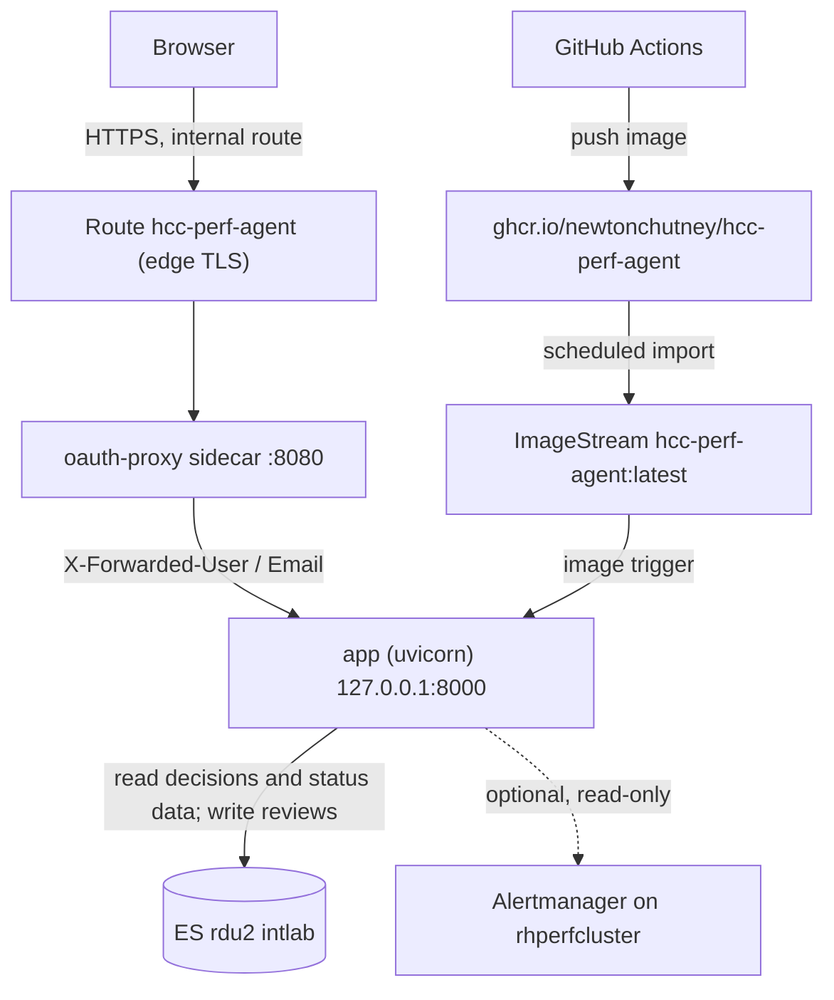

# Deploying the web UI on rdu3

The UI runs in `hceperf--runtime-int` on `prod-scale-spoke1-dc-rdu3` (the namespace where
the CPT Jenkins agents run) at
<https://hcc-perf-agent.apps.int.prod-scale-spoke1-dc-rdu3.itup.redhat.com> (Red Hat network
only; sign in with the cluster's SSO).



## Why it's built this way

- **No in-cluster builds.** The cluster rejects both the Docker and Source build strategies.
  Its image registry has no external route either. GitHub Actions builds the image
  ([`.github/workflows/image.yaml`](../.github/workflows/image.yaml)) and the ImageStream
  imports it from GHCR.
- **Sign-in via oauth-proxy.** Any user who can sign in to the cluster can open the UI. The
  app only listens on localhost, so the identity headers can only come from the proxy.
  Reviews record that identity.
- **No Slack (yet).** The Jenkins Slack token can't be reused: the build log shows
  `slackSend ... botUser: false`, so it's the legacy "Jenkins CI" integration token. It can
  only post messages: no buttons, no channel history, no Socket Mode. It also lives on the
  `jenkins-csb-perf-master.dno` controller, not on rdu3. The UI replaces Slack until our own
  Slack app is approved (`slack-app-manifest.yaml`, ARCHITECTURE.md section 10).

## First-time setup

```sh
C=hceperf--runtime-int/api-prod-scale-spoke1-dc-rdu3-prod-scale-mgmthub1-dc-rdu3-itup-redhat-com:6443/nmucheli

# Cookie secret for oauth-proxy (never commit it)
oc --context $C -n hceperf--runtime-int create secret generic hcc-perf-agent-oauth-cookie \
  --from-literal=cookie-secret="$(head -c 24 /dev/urandom | base64 | tr -d '\n=' | tr '+/' '-_' | head -c 32)"

oc --context $C apply -k deploy/base
```

## Updating

To update, push to `main`. GitHub Actions publishes `ghcr.io/newtonchutney/hcc-perf-agent:main`,
and the scheduled import picks it up within about 15 minutes. To import right away, run
`oc import-image hcc-perf-agent:latest`. Either way the image trigger rolls out the
Deployment.

To run a branch build, run `oc tag --scheduled ghcr.io/newtonchutney/hcc-perf-agent:<branch> hcc-perf-agent:latest`.
The next `oc apply -k deploy/base` resets it to `main`.

## Reviews change results (ReportPortal replacement)

A review by a user in `WRITEBACK_USERS` sets the run's `result` the way
`UtilResultsFromRPToES` did for ReportPortal overrides:

| Review category | Result | RP defect type it replaces |
|---|---|---|
| `possible_baseline_false_positive` | PASS | `no_defect` |
| `environment_failure` | ERROR | `system_issue` |
| `true_failure`, `known_issue`, `requires_investigation` | FAIL | `product_bug`, `to_investigate` |

- **What it writes:** `result` plus a `comments` entry (author, date, reason) on the
  status-data document, and `result` on the matching `results-dashboard-data` document.
- **Effect on baselines:** baseline queries take golden runs with `result: PASS`, so a
  review that sets PASS adds the run to later baselines, just as an RP override did.
- **Who:** `WRITEBACK_USERS` in `deploy/base/deployment.yaml`. It's `*` for now, so any user
  signed in to the cluster can change results. To restrict it, list cluster user names,
  comma-separated; reviews by anyone else are then recorded but don't change results.
- **Undo:** submit a corrected review; the new category sets the result again and adds
  another comment.
- **Off switch:** `WRITEBACK_ENABLED=false`.

## Chat (optional)

The Chat page and the panel on each run page answer questions with an EnMaaS model.
Users pick GLM 5.3 (the default, `LLM_MODEL`), DeepSeek V4.1 Flash or Muse Spark; set
`LLM_MODELS` (`id=Label,...`) to change the list. The server rejects any other model. The model reads CPT data only through read-only tools in
`agent/web/chat.py`. Chat stays disabled until the key exists. Read the key from a file so
it stays out of shell history:

```sh
oc --context $C -n hceperf--runtime-int create secret generic hcc-perf-agent-llm \
  --from-file=api-key=/path/to/enmaas-key
oc --context $C -n hceperf--runtime-int rollout restart deploy/hcc-perf-agent
```

Pods on rdu3 can't connect to EnMaaS or AWS directly; the connection times out. So calls to
both go through `squid.corp.redhat.com:3128` (`EGRESS_PROXY`), while ES traffic stays direct.

### AWS (RDS) evidence

The `rds_metrics` chat tool reads live Performance Insights data (DB load, CPU, IOPS, top
SQL and wait events) and CloudWatch data (connections, memory, latency) for the databases
behind a run, over the run's load window. The databases are matched from the run's pod
names, e.g. `kessel-inventory-api` matches `kessel-inventory-perf`.

It uses the perf team's read-only Performance Insights key (IAM user
`consoledot-perf-team-rds-pi-reader`). The key comes from `iperf-secret` in namespace `cpt`
on rhperfcluster. To refresh it after a rotation, while logged in to both clusters:

```sh
oc --context <rhperfcluster> -n cpt get secret iperf-secret -o json | jq '{apiVersion:"v1",kind:"Secret",
  metadata:{name:"hcc-perf-agent-aws",namespace:"hceperf--runtime-int"},
  data:{AWS_REGION:.data.AWS_CLOUDWATCH_REGION,PI_ACCESS_KEY_ID:.data.AWS_PI_READ_ONLY_ACCESS_KEY_ID,
        PI_SECRET_ACCESS_KEY:.data.AWS_PI_READ_ONLY_SECRET_ACCESS_KEY}}' | oc --context $C apply -f -
oc --context $C -n hceperf--runtime-int rollout restart deploy/hcc-perf-agent
```

The `AWS_CLOUDWATCH_*` key pair in that secret is invalid (`InvalidClientTokenId`); the PI
key also reads CloudWatch.

Each question is logged with the user, the tools called, and the duration (`oc logs
deploy/hcc-perf-agent -c app`). Answers aren't stored.

## Perf-cluster alerts (optional)

The Alerts page stays disabled until it has a token. On `rhperfcluster`, create a
ServiceAccount with `monitoring-alertmanager-view` in `openshift-monitoring`, then:

```sh
oc --context $C -n hceperf--runtime-int create secret generic hcc-perf-agent-perf-cluster \
  --from-literal=token="<long-lived SA token>"
# mount it at /var/run/secrets/perf-cluster/token and set
# ALERTMANAGER_URL=https://<host of the alertmanager-main route in openshift-monitoring>
```

## Local development

```sh
python3 -m venv .venv && .venv/bin/pip install -r requirements.txt pytest
.venv/bin/python -m pytest -q tests
DEV_USER=$USER .venv/bin/uvicorn agent.web.app:app --reload   # http://127.0.0.1:8000
# chat: LLM_API_KEY=... (or LLM_API_KEY_FILE=...) in the same command
```

Set `REVIEWS_INDEX` to a scratch index when you try out review writes locally.
