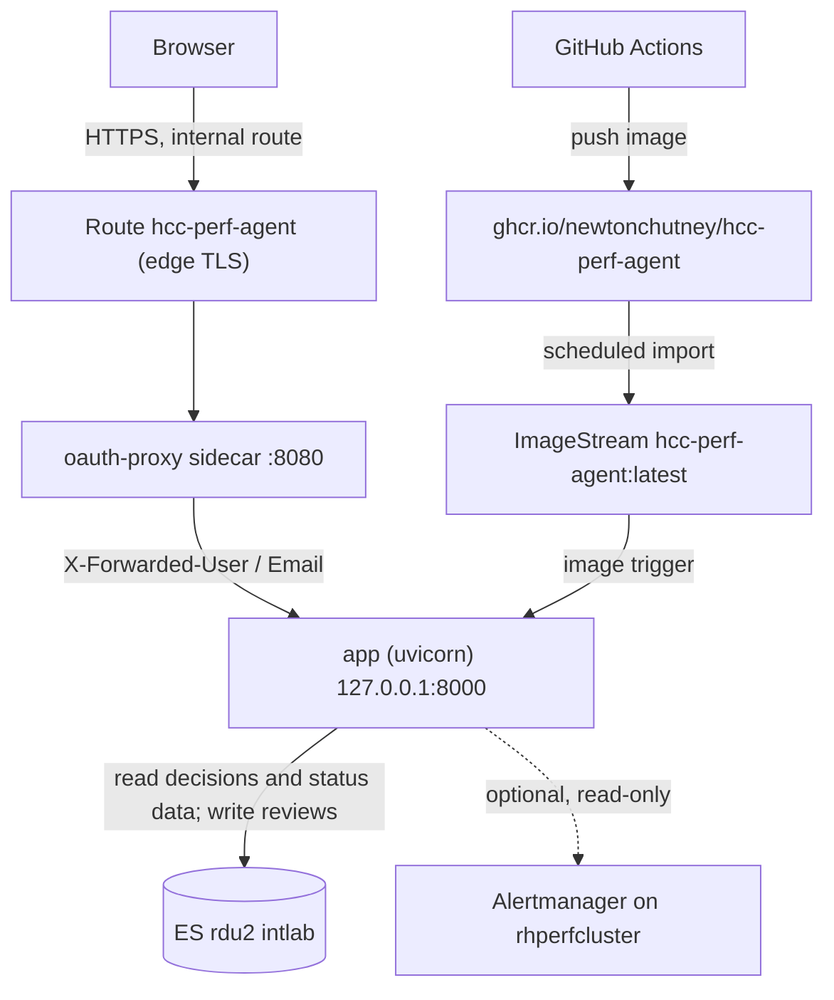

# Deploying the web UI on rdu3

The UI runs in `hceperf--runtime-int` on `prod-scale-spoke1-dc-rdu3` (the namespace where
the CPT Jenkins agents run) at
<https://hcc-perf-agent.apps.int.prod-scale-spoke1-dc-rdu3.itup.redhat.com> (Red Hat network
only; sign in with the cluster's SSO).



## Why it's built this way

- **No in-cluster builds.** The cluster rejects both the Docker and Source build strategies.
  Its image registry has no external route either. GitHub Actions builds the image
  ([`.github/workflows/image.yaml`](../.github/workflows/image.yaml)) and the ImageStream
  imports it from GHCR.
- **Sign-in via oauth-proxy.** Any user who can sign in to the cluster can open the UI. The
  app only listens on localhost, so the identity headers can only come from the proxy.
  Reviews record that identity.
- **No Slack (yet).** The Jenkins Slack token can't be reused: the build log shows
  `slackSend ... botUser: false`, so it's the legacy "Jenkins CI" integration token. It can
  only post messages: no buttons, no channel history, no Socket Mode. It also lives on the
  `jenkins-csb-perf-master.dno` controller, not on rdu3. The UI replaces Slack until our own
  Slack app is approved (`slack-app-manifest.yaml`, ARCHITECTURE.md section 10).

## First-time setup

```sh
C=hceperf--runtime-int/api-prod-scale-spoke1-dc-rdu3-prod-scale-mgmthub1-dc-rdu3-itup-redhat-com:6443/nmucheli

# Cookie secret for oauth-proxy (never commit it)
oc --context $C -n hceperf--runtime-int create secret generic hcc-perf-agent-oauth-cookie \
  --from-literal=cookie-secret="$(head -c 24 /dev/urandom | base64 | tr -d '\n=' | tr '+/' '-_' | head -c 32)"

oc --context $C apply -k deploy/base
```

## Updating

To update, push to `main`. GitHub Actions publishes `ghcr.io/newtonchutney/hcc-perf-agent:main`,
and the scheduled import picks it up within about 15 minutes. To import right away, run
`oc import-image hcc-perf-agent:latest`. Either way the image trigger rolls out the
Deployment.

To run a branch build, run `oc tag --scheduled ghcr.io/newtonchutney/hcc-perf-agent:<branch> hcc-perf-agent:latest`.
The next `oc apply -k deploy/base` resets it to `main`.

## Perf-cluster alerts (optional)

The Alerts page stays disabled until it has a token. On `rhperfcluster`, create a
ServiceAccount with `monitoring-alertmanager-view` in `openshift-monitoring`, then:

```sh
oc --context $C -n hceperf--runtime-int create secret generic hcc-perf-agent-perf-cluster \
  --from-literal=token="<long-lived SA token>"
# mount it at /var/run/secrets/perf-cluster/token and set
# ALERTMANAGER_URL=https://<host of the alertmanager-main route in openshift-monitoring>
```

## Local development

```sh
python3 -m venv .venv && .venv/bin/pip install -r requirements.txt pytest
.venv/bin/python -m pytest -q tests
DEV_USER=$USER .venv/bin/uvicorn agent.web.app:app --reload   # http://127.0.0.1:8000
```

Set `REVIEWS_INDEX` to a scratch index when you try out review writes locally.
